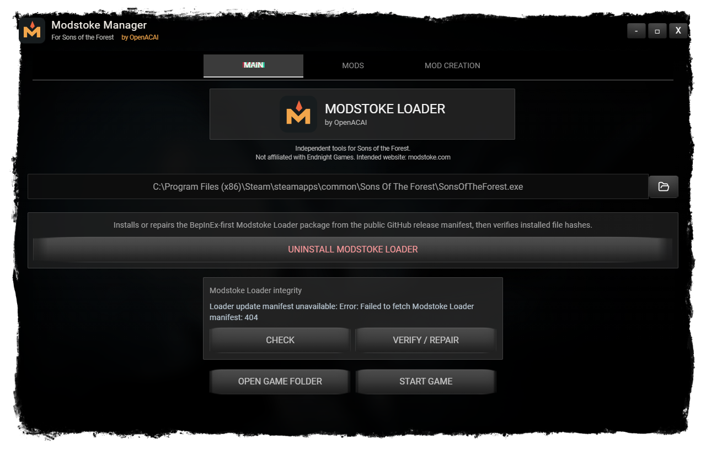

# Modstoke Manager

Modstoke Manager is a Windows mod manager for **Sons of the Forest**, maintained by OpenACAI. It is based on [RedManager](https://github.com/ToniMacaroni/RedManager) by Toni Macaroni. The app brings the SOTF Mods and Nexus Mods catalogs together, shows installed mods, and manages Modstoke Loader files.



The current Manager source is on the [`openacai-tauri2-svelte5-shell` branch](https://github.com/desertofunknown/openacai-mod-manager/tree/openacai-tauri2-svelte5-shell). The repository name and some installed paths still use OpenACAI names for compatibility.
The website and its catalog are separate work; the Manager still uses its existing catalog and update addresses. See the [rename compatibility notes](docs/BRAND_COMPATIBILITY.md) and [changelog](CHANGELOG.md).

## Download the Windows app

The repository contains signed **0.2.0** baseline downloads:

- [Portable app, Windows x64](https://github.com/desertofunknown/openacai-mod-manager/blob/openacai-tauri2-svelte5-shell/prebuilt/OpenACAI-Mod-Manager-0.2.0-x64-portable.exe?raw=1)
- [Installer, Windows x64](https://github.com/desertofunknown/openacai-mod-manager/blob/openacai-tauri2-svelte5-shell/prebuilt/OpenACAI-Mod-Manager-0.2.0-x64-setup.exe?raw=1)
- [SHA256 checksums](https://github.com/desertofunknown/openacai-mod-manager/blob/openacai-tauri2-svelte5-shell/prebuilt/SHA256SUMS.txt)

These signed files still display **OpenACAI Mod Manager**. The Modstoke branding is in the newer source branch; building that branch does not make a new signed release. You can [check a download's hash and signature](docs/TROUBLESHOOTING.md#check-a-downloaded-executable) before running it.

## Get started

1. Run the portable app or installer on Windows 10 or 11. WebView2 is required; the installer is configured to bootstrap it if needed.
2. Select `SonsOfTheForest.exe` in your game installation folder.
3. Open **Mods** to browse SOTF Mods and Nexus Mods or inspect your installed mods. Nexus file installation is handed to Vortex. Manage Vortex deployments in Vortex.

**Loader installation is currently blocked by its release feed.** The Manager's install and repair actions request `OpenACAILoader.manifest.json` from [the old loader release URL](https://github.com/desertofunknown/openacai-loader/releases/latest/download/OpenACAILoader.manifest.json), which is unavailable at present. The current UI does not offer a working local ZIP picker. These actions will need a compatible public loader release feed or a code update before they can install or repair Modstoke Loader. See [troubleshooting](docs/TROUBLESHOOTING.md) for the errors you may see.

Nexus browser sign-in also depends on Nexus Mods approving the Manager application. The manual API key option is intended for development testing.

## Develop on Windows

Install Node.js 22.12 or newer, Rust/Cargo, and the [Tauri 2 Windows prerequisites](https://v2.tauri.app/start/prerequisites/#windows), including Visual Studio C++ build tools and WebView2. You can build the Manager without installing the game or a .NET SDK. Building the separate loader package has different requirements.

```powershell
git clone --branch openacai-tauri2-svelte5-shell --single-branch https://github.com/desertofunknown/openacai-mod-manager.git
cd openacai-mod-manager
npm ci
npm run check
npm run tauri dev
```

For a local Windows build:

```powershell
npm run tauri build
```

The executable is written under `src-tauri/target/release/`; the NSIS installer is under `src-tauri/target/release/bundle/nsis/`. Local builds are not signed by the repository's public signing identity. `npm run build` builds only the web frontend.

The Svelte frontend lives in `src/`, and the Rust/Tauri backend in `src-tauri/`. Loader, SDK, and Admin are separate projects. Admin is not included in this repository or its Manager downloads.

## Credits and licenses

OpenACAI-authored Manager changes are licensed under [GPL-3.0-or-later](https://github.com/desertofunknown/openacai-mod-manager/blob/openacai-tauri2-svelte5-shell/LICENSE). The RedManager source retains its [Apache-2.0 license](https://github.com/desertofunknown/openacai-mod-manager/blob/openacai-tauri2-svelte5-shell/LICENSES/Apache-2.0.txt). See the [third-party notices](https://github.com/desertofunknown/openacai-mod-manager/blob/openacai-tauri2-svelte5-shell/THIRD_PARTY_NOTICES.md) and [upstream lineage](https://github.com/desertofunknown/openacai-mod-manager/blob/openacai-tauri2-svelte5-shell/UPSTREAMS.md) for other components.

Some bundled Sons of the Forest UI assets belong to Endnight Games and have project-specific, noncommercial permission for this tool. They are not covered by the Manager's GPL license; see their [asset notice](https://github.com/desertofunknown/openacai-mod-manager/blob/openacai-tauri2-svelte5-shell/src/assets/sons-ui/NOTICE.txt). Modstoke Manager is independent and is not endorsed by Endnight Games.

